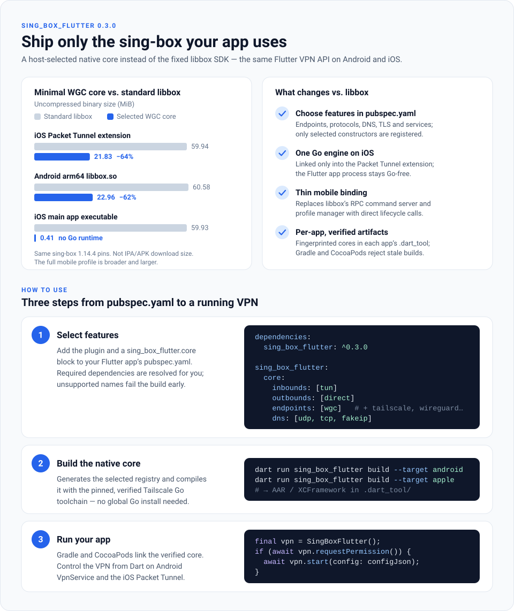

# sing_box_flutter

[Project website](https://sing-box-flutter.idy.dev/) · [Feature guide](doc/core-features.md)

An independent Flutter plugin for running [sing-box](https://github.com/SagerNet/sing-box)
as a native VPN on Android, iOS, macOS, Windows (Wintun) and Linux. Select the
compiled protocols in your host
`pubspec.yaml` and build them from source with the pinned **Tailscale Go** compiler.



Sizes compare uncompressed binaries for the minimal WGC profile; see
[measured builds](doc/core-features.md#measured-minimal-wgc-build).

This project is not affiliated with or endorsed by SagerNet or Tailscale.

## Platform support

Requires **Flutter 3.47.2+**. The Android integration uses AGP 9.1 with built-in
Kotlin and JDK 17; the checked-in example and CI use the same Flutter toolchain.

| Platform | Native integration | Minimum version |
| --- | --- | --- |
| Android | Foreground `VpnService`, socket protection, network monitoring | Android 7 / API 24 |
| iOS | `NEPacketTunnelProvider` in a separately signed host extension | iOS 15 |
| macOS (NE) | `NEPacketTunnelProvider` in a separately signed host extension | macOS 12 |
| macOS (user TUN) | Native `utun`, core-managed routes and DNS, unsandboxed administrator process | macOS 12 |
| Windows | Bundled core process, native Wintun adapter and routes; elevated host | Windows 10, x64 / ARM64 |
| Linux | Native TUN/routing in a bundled Go helper; ordinary-user Flutter UI | x86_64 / arm64, Flutter GTK 3 host |

Flutter controls the native core and receives typed connection events. Mobile uses
method channels; Windows and Linux use private child-process pipes. Packet processing
stays in the native core. Cancelling a stream subscription does not disconnect the
VPN. Mobile services survive UI closure; desktop child helpers clean up when their
owning application exits.

The first release provides core version lookup, configuration validation, explicit
VPN consent, start/stop, and connection status. It accepts complete sing-box JSON;
it does not provide a profile editor, subscription manager, or Tailscale account UI.

## Install and build from source

Version 0.3.0 ships source and build scripts. Its GitHub Release has no universal
precompiled libbox `.a`, AAR or XCFramework SDK assets. Compile the capabilities
your app needs from the pinned sources.

Add the dependency and a top-level feature selection to your **Flutter app's**
`pubspec.yaml`, alongside its existing `flutter` configuration:

```yaml
dependencies:
  sing_box_flutter: ^0.3.1

sing_box_flutter:
  core:
    inbounds: [tun]
    outbounds: [direct]
    endpoints: [wgc]
    dns: [udp, tcp, fakeip]
```

Install these build prerequisites:

- Python 3.11+ and Git. Python is also used when Gradle, SPM or CocoaPods validates
  a selected core; no third-party Python packages are needed.
- For Android: OpenJDK 17, the Android SDK and NDK `28.0.13004108`.
- For iOS: macOS with Xcode and its iPhoneOS/simulator SDKs, using SPM or CocoaPods
  for the Flutter host integration. See [Apple SPM setup](doc/apple-spm.md).
- For macOS: Xcode and SPM or CocoaPods, plus the backend-specific host setup described
  in [macOS setup](doc/macos-setup.md).
- For Windows packaging: Windows with Visual Studio's Desktop development with C++
  workload, Windows SDK and CMake 3.27+. The Go core also cross-compiles from macOS/Linux.
- For Linux: CMake 3.19+, Clang, Ninja, pkg-config and GTK 3 development headers.

The builder automatically downloads and verifies the pinned **Tailscale Go**
compiler and mobile tools. You do not need to install Go globally. The installed
app needs no separate Go installation; its native core contains the Go runtime.
See [native build details](doc/native-build.md) for SDK configuration and caches.

Run these commands from your Flutter app, selecting the platform you need:

```bash
flutter pub get
dart run sing_box_flutter build --target android
```

```bash
dart run sing_box_flutter build --target apple
```

```bash
dart run sing_box_flutter build --target windows --windows-arch amd64
```

For Windows ARM64, use `--windows-arch arm64`. The helper embeds the verified
official Wintun driver through the pinned sing-tun module. Deploy the complete
bundle to a trusted administrator-owned installation directory and run the host
as administrator to create its adapter. User-writable helper locations are rejected.
Follow [Windows setup](doc/windows-setup.md) for packaging, UAC and lifecycle details.

```bash
dart run sing_box_flutter build --target linux --arch amd64
```

Use `--arch arm64` for ARM64 Linux. Linux requires a host feature selection.

The builder generates a constructor registry and compiles a small mobile binding
layer directly against the pinned sing-box engine. It does not link the official
libbox RPC/profile-management layer. Windows and Linux use separate helpers against
the same selected engine registry, with native Wintun or TUN handling. Required
dependencies, such as WGC's userspace network stack or Hysteria2's QUIC
implementation, are resolved automatically. Windows and Linux require explicit
build targets; a selected `all` build includes Android, Apple and macOS.

Artifacts stay in your app's `.dart_tool/sing_box_flutter/`, keyed by feature and
source fingerprints. Gradle, Apple SPM/CocoaPods and desktop CMake resolve that app's artifact; changing
another app's selection does not overwrite binaries in a shared pub cache.
Rebuild the core after editing the host pubspec, then rebuild the app (on iOS,
rerun `pod install` or let Flutter run it). Neither `flutter pub get` nor a normal
app build silently downloads Go or compiles a new core.

Add `tailscale` or `wireguard` to `endpoints`, or protocols such as `vless`,
`shadowsocks`, and `hysteria2` to `outbounds`. Missing capabilities and unsupported
platform selections fail explicitly. A selected core requires a source build;
`install` cannot satisfy a host feature selection.

The example includes [WGC minimal, WGC + Tailscale and full mobile
profiles](example/core-profiles/README.md), with a tool that switches only its
pubspec feature block. See [feature selection](doc/core-features.md) for defaults,
dependencies, validation semantics, architecture options and the complete
capability catalogue.

### Legacy standard-core compatibility

Hosts without a `sing_box_flutter.core` block retain the standard build/install
path. The installer remains available for historical binary releases such as
`v0.2.0`; 0.3.0 does not publish replacement SDK assets:

```bash
dart run sing_box_flutter install --target android --release v0.2.0
```

```bash
dart run sing_box_flutter install --target apple --release v0.2.0
```

This legacy installer requires Python 3.11+, verifies release checksums and pinned
build metadata, and places artifacts in the resolved plugin directory. Reinstall
them after changing the package version or clearing your pub cache. The standard
source-build helper is also retained; see [legacy build and install details](doc/native-build.md#legacy-standard-core-build-and-install).

### Android host setup

The plugin declares its VPN service and required permissions. Set the host's
`minSdk` to at least 24. VPN consent requires an attached Flutter Activity.
Android runs the service in the foreground with a persistent notification.

### iOS host setup

A Flutter plugin cannot create or sign the host application's Network Extension.
Add a Packet Tunnel extension target, embed it in the app, and configure matching
App Group entitlements on the app and extension. The extension depends on the
plugin's `PacketTunnel` CocoaPods subspec or the host-local SPM
`sing-box-flutter-packet-tunnel` product. It does not embed Flutter.

Follow [the complete iOS setup guide](doc/ios-setup.md) before running the app.
A physical device is required to test VPN traffic; the simulator can validate
compilation and the UI only.

### macOS host setup

Select one backend in the host `pubspec.yaml`, alongside `core`:

```yaml
sing_box_flutter:
  macos:
    mode: ne # or user_tun
  core:
    inbounds: [tun]
    outbounds: [direct]
    endpoints: [wgc]
    dns: [udp, tcp, fakeip]
```

```bash
dart run sing_box_flutter build --target macos
```

`ne` (the default) uses a separately signed Packet Tunnel extension and App Group,
keeping Go out of the Flutter app process. `user_tun` links the core in the host
process and lets sing-box create `utun`, routes and DNS directly. It requires an
unsandboxed process already running with administrator privileges; this plugin
does not install a privileged helper or elevate the Flutter app.

The selection controls SPM or CocoaPods source/link dependencies at build time.
Rebuild the core after changing it, then rebuild the app (rerun `pod install` for
CocoaPods). Both modes expose the same Dart API. Follow [the macOS setup guide](doc/macos-setup.md) for host targets,
entitlements, permissions and validation.

### Linux host setup

Linux runs the bundled core as a child process and uses upstream TUN, routing and
network monitoring. Userspace packet processing still needs `/dev/net/tun` and
`CAP_NET_ADMIN`; grant capabilities to the core helper rather than running the
Flutter UI as root. `requestPermission()` checks TUN access without opening an
elevation dialog. See [Linux build, permissions and lifecycle](doc/linux-setup.md).

## Dart API

```dart
import 'package:sing_box_flutter/sing_box_flutter.dart';

final vpn = SingBoxFlutter();

await vpn.initialize(
  // Required on Windows; keep stable across updates and install-directory changes.
  applicationId: 'com.example.myapp',
  // Required on iOS and macOS NE; omit on Android, Linux, Windows and macOS user_tun.
  appGroup: 'group.com.example.app',
  providerBundleIdentifier: 'com.example.app.PacketTunnel',
  notificationTitle: 'Example VPN',
);

final subscription = vpn.status.listen((status) {
  print(status.state); // disconnected/connecting/connected/disconnecting/error
});

await vpn.checkConfig(configJson);
if (await vpn.requestPermission()) {
  await vpn.start(config: configJson, name: 'Example VPN');
}

// start() acknowledges the request. Observe the stream for connection success.
final current = await vpn.getStatus();
final version = await vpn.getVersion();

// Disconnect explicitly; disposing the Flutter UI does not own the native VPN.
await vpn.stop();
await subscription.cancel();
```

Invalid JSON is rejected locally. Android, Windows and Linux use native engine checks; iOS
`checkConfig` performs structural/capability preflight in the Go-free app, with
full engine validation deferred to extension startup. A successful iOS preflight
does not guarantee startup. Validation and connection failures surface as
`PlatformException`; the plugin avoids including configurations or
authentication keys in its own errors. Treat your configuration JSON as sensitive
and do not write it to application logs.

Multiple plugin objects refer to the same native VPN service. Only one connection
is managed by this plugin at a time. A new event-channel subscription receives the
current native status. Use `getStatus()` to refresh a UI after it resumes.

## WGC support

The matching native build includes a `wgc` endpoint backed directly by
[`idy/wgc`](https://github.com/idy/wgc). Pass ordinary sing-box JSON through the
existing `checkConfig` / `start` methods; the Flutter API and Android/iOS VPN
host remain unchanged. See [WGC endpoint configuration](doc/wgc.md) for keys,
routing, and compiled application transport hooks. This does not copy the WGC
protocol implementation into this repository.

## Tailscale support

Add `tailscale` to `core.endpoints` (and to `core.dns` if using its DNS transport),
then rebuild the selected core. The builder retains the upstream mobile
memory-saving options. Include the endpoint in normal sing-box JSON:

```json
{
  "endpoints": [{
    "type": "tailscale",
    "tag": "tailnet",
    "hostname": "my-flutter-app",
    "system_interface": false,
    "accept_routes": false,
    "exit_node": "100.64.0.10"
  }]
}
```

This is an endpoint fragment, not a complete VPN configuration. Add a TUN inbound,
DNS rules, and routes selecting `tailnet` for the desired traffic. The native core
owns the Tailscale connection inside the same VPN service. Platform VPN limits
mean the design should not depend on another Tailscale VPN app running alongside it.

For unattended authentication, provide an appropriately scoped Tailscale auth key
through your application's secure configuration flow. The plugin does not yet
expose an interactive Tailscale login or endpoint-management API. Do not depend on
log messages as an authentication protocol. See the upstream
[Tailscale endpoint documentation](https://sing-box.sagernet.org/configuration/endpoint/tailscale/).

## Reproducible native builds

All Go compilation uses the Tailscale-maintained Go fork. The build refuses to
substitute a system Go toolchain. Inputs are fixed in [native-core.json](native-core.json):

- sing-box: `1.14.4`, revision `c005f35300ce76427dc285481ec5695f5b179cd2`.
- Tailscale Go: revision `63ae404c8203317fd3c82d972e5dc8f0fcb425cb`.
- SagerNet gomobile: `v0.1.12`.

Use the host-selected `dart run sing_box_flutter build` commands above, whether
the dependency comes from pub.dev or a local source checkout. The builder
bootstraps the pinned compiler automatically; it never substitutes a system Go
installation. Toolchains and source caches live under `.build/` inside the package
checkout, while selected artifacts stay in the host app's `.dart_tool/`.

The pub package must retain `native/mobile/`, `native/windows/`, `native/linux/`,
`native/wgc/`, `windows/`, `linux/`, `tool/`, pin files and
license notices so hosts can build from source. Build caches and native outputs
are excluded from Git and pub.dev. Temporary CI binary archives are validation
inputs, not 0.3.0 GitHub Release SDK assets. See [native build details](doc/native-build.md)
for SDK prerequisites, verification, artifact provenance and the source-only
publication policy.

## Example and development

The standalone project website is built from `site/`. See the
[website development and deployment guide](doc/website.md) for local preview,
GitHub Pages and custom-domain setup.

The [example](example/) accepts editable sing-box JSON and demonstrates permission,
validation, connection status, and explicit disconnection. Its default configuration
captures traffic through a TUN and routes it directly; it does not connect to an
external proxy or Tailscale network automatically.

```bash
flutter pub get
```

```bash
flutter analyze
```

```bash
flutter test
```

Run the example's widget test from `example/`:

```bash
flutter test
```

```bash
flutter pub publish --dry-run
```

Native compilation and physical-device VPN tests are separate from Dart unit tests.
Before shipping an app, test DNS, IPv4/IPv6, lock/unlock, Wi-Fi/cellular transitions,
permission revocation, and UI restarts on the actual supported OS versions.

## Automated pull-request review

[OpenAI PR review](.github/workflows/openai-code-review.yml) uses the maintained
[GizClaw reviewer](https://github.com/GizClaw/github-workflows) through its `latest`
tag. Configure an `OPENAI_API_KEY` Actions secret in this repository before use.
The caller must be merged into the default branch before its trusted review
worker can run.

Ready PRs are reviewed automatically when opened, reopened, edited, or updated.
Post `@codex review` on its own line in a new PR comment to request a fresh review,
or run the workflow manually with a PR number. Editing a linked Issue also
refreshes its open PRs. Retry with a new request instead of rerunning an old run.

The reviewer publishes `OpenAI PR Review`, `OpenAI Issue Review`, and
`OpenAI Code Review` checks on the reviewed commit. It focuses on Android/iOS VPN
lifecycle, Flutter channel compatibility, sensitive configuration, and native
artifact integrity. These checks complement the existing tests; physical-device
VPN validation remains a separate requirement.

## License

GPL-3.0-or-later. See [LICENSE](LICENSE) and
[THIRD_PARTY_NOTICES.md](THIRD_PARTY_NOTICES.md), including the upstream core's
additional naming and association notice. Distributing an application that links
libbox carries the applicable source and notice obligations.
